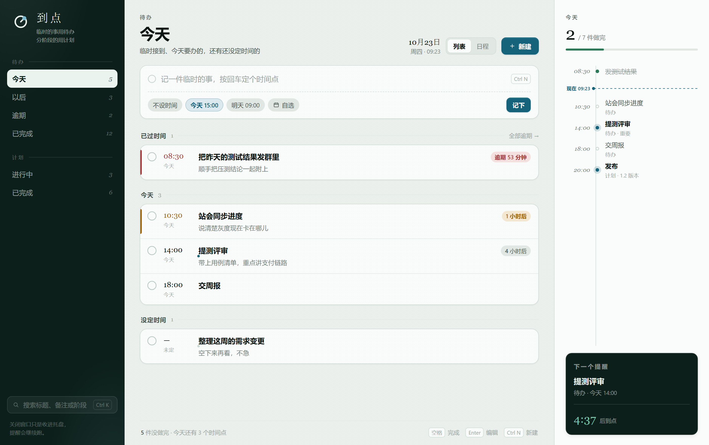
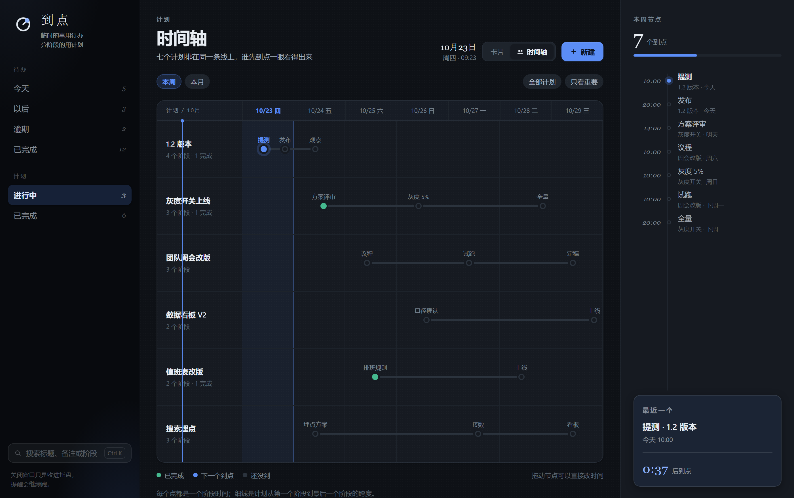
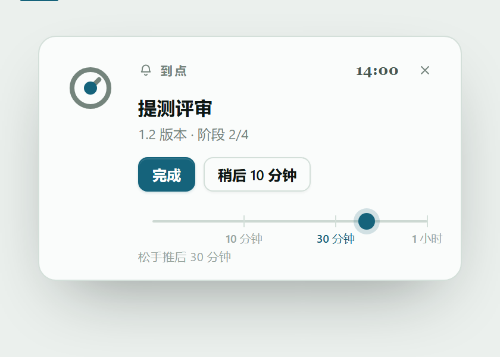
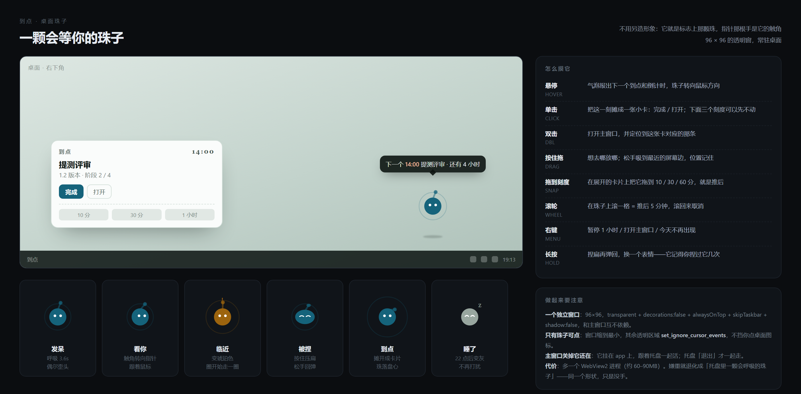

<p align="center">
  
</p>

<h1 align="center">到点</h1>

<p align="center">
  临时的事用待办，分阶段的用计划。<br>
  给每一件事一个时间点，到点提醒一次。
</p>

---

## 它解决什么

多数待办工具只有一个「截止日期」。可真实的事情分成两类：

- **临时的事**——领导丢过来一句、群里 @ 你一下。只有一件事、一个时间点，处理完就完了。
- **分阶段的事**——一个版本要提测、发布、观察；一次改版要出方案、试跑、定稿。它是一件事，但有好几个「到点」，每个都得提醒。

到点把这两类放在同一个窗口里：**一件事一个时间点，或者一件事几个阶段、几个时间点**。到点弹系统通知，窗口关了也在；桌面上还有一颗珠子替你盯着。

## 长什么样

<table>
<tr>
<td width="50%"><br><sub>待办 · 今天（青瓷）</sub></td>
<td width="50%"><br><sub>计划 · 时间轴（夜航）</sub></td>
</tr>
</table>

## 能做什么

**记一条**　顶部一行记下，时间点四选一（不设时间 / 今天 15:00 / 明天 09:00 / 自选）。分「今天 / 以后 / 逾期 / 已完成」四栏，逾期和快到点的行左边有颜色条。点开是详细编辑：时间、重要程度、备注。

**重复**　每天 / 每周 / 每个工作日 / 每月最后一天 / 每 N 天。可以跳过周末（节假日、调休日在设置里补），可以设一个截止日期，也可以「跳过这一次」只推掉当下这轮。

**拆一件事**　一份计划拆成最多 20 个阶段，每个阶段一个时间点。卡片上是一条阶段进度线，下一个到点的阶段单独标出来；也能切成时间轴，把几份计划排在同一条日历线上。

**模板**　「提测 → 发布 → 观察」这类固定节奏存成模板，下次一键铺开；常用的模板会出现在输入框下面。

**提醒**　到点弹系统通知，同时窗口里出现一张「珠子落盘」卡片——标志上那颗珠从盘沿落到盘心。稍后不用点按钮：把珠子往右拖，落在 10 分钟 / 30 分钟 / 1 小时哪个刻度，就延后到哪。



**桌面珠子**　一颗常驻桌面右下角的小珠子（就是标志上那颗）。它会随状态变表情：发呆、快到点、到点、深夜睡觉；拖到哪都行，松手吸附屏幕边；按住会捏扁再弹回；双击打开主窗口；右键可以「暂停 1 小时」或打开主窗口。到点时它自己摊成一张小卡，直接在桌面上完成或推后。



**快速记录**　任何时候按下全局快捷键（默认 `Alt + Space`），弹出一个只有一行的小窗，写完回车就进待办，不用切回主窗口。

**日历**　选一个本地 `.ics` 文件（Outlook、飞书、Google 日历导出的都行），会议和你的待办、阶段会排在同一条时间轴上，一眼看出哪几个会撞车。

**推到群里**　配好飞书或企业微信的机器人 Webhook，到点除了弹本机通知，还能把这条同步发到群里。

**一句话变成计划**　填好 DeepSeek 的 Key 之后：待办里写「明天下午三点交周报」，它自己解析出时间；计划里写「1.2 版本要提测、发布、观察」，它自己拆成三个阶段并给时间建议。Key 用 Windows DPAPI 加密存在本机。

**周报**　按本周范围自动拼出「概览 / 待办 / 计划推进」的周报草稿，模板可在设置里改，一键复制成纯文本。

**窗口**　三档尺寸——迷你 / 标准 / 宽，各自记住自己的大小和位置。关窗口不退出，缩进托盘继续跑；托盘菜单里有「打开到点 / 迷你窗 / 退出」。托盘被安全策略挡住时会退化成最小化到任务栏。

**两套主题**　青瓷（浅）/ 夜航（深），左下角切换，记在本机。

## 快捷键

| 键 | 作用 |
| --- | --- |
| `Alt Space` | 快速记录（全局，可在设置里改） |
| `Ctrl N` | 新建当前板块的条目 |
| `Ctrl K` | 跳到搜索框（标题、备注、阶段名） |
| `Ctrl S` | 在编辑抽屉里保存 |
| `Esc` | 关掉编辑抽屉 |

## 提醒的规则

提醒是为了不漏，不是为了多响。

- **同一条只响一次**；阶段里错过的那些只记账，不逐条补发。
- **免打扰 22:00–08:00**：到点照算，但不弹；第二天 8 点合并成一条。
- **每小时最多 3 条**，超出的先攒着，整点后合并。
- **同一批合并**：「3 件到点 · 提测评审、交周报 等 3 件」，不连着弹三条。
- **发不出去会退避**：同一条最多试 3 次，之后只记账，不会再每 20 秒刷一次通知中心。

## 设置

设置是一个抽屉，分十一组：外观与窗口、重复与工作日、工作时间、周报、日历、飞书与企业微信、桌面珠子、快速记录、DeepSeek、数据备份与恢复、数据导出。

## 技术栈

| | |
| --- | --- |
| 桌面壳 | Tauri 2（Rust） |
| 界面 | Vue 3 + TypeScript + Vite，没有组件库，组件和样式都是自己的 |
| 存储 | 本机 JSON，不上传 |
| 通知 | Windows：WinRT toast + 自注册 AUMID；其他平台：`tauri-plugin-notification` |
| 导出 | SheetJS 生成 `.xlsx` |

```
Vue 3 (src/)
  AppShell ─ 待办 / 计划 / 设置抽屉 / 提醒卡片
  PetApp   ─ 桌面珠子（独立窗口，可点击穿透）
  QuickCapture ─ 全局快捷键小窗
      │ invoke
      ▼
Tauri 命令（store / settings / pet / calendar / webhook / deepseek / backup）
      ▼
store.json · templates.json · settings.json · backups/
      ▲
remind.rs  线程：算下一个到点 → 睡到那时 → 检查 → 发通知 → 记账
      ├─ win_toast.rs       Windows WinRT toast
      ├─ win_balloon.rs     托盘气泡（通知不可用时的退路）
      └─ webhook.rs         飞书 / 企业微信
```

## 目录

```
.
├─ src/                      前端
│  ├─ features/shell/        外壳、主题、提醒卡片、窗口三档、快捷键
│  ├─ features/todos/        待办页、行、编辑器、周报
│  ├─ features/plans/        计划页、卡片、时间轴、编辑器
│  ├─ features/pet/          桌面珠子
│  ├─ features/settings/     设置抽屉
│  ├─ domain/                类型、时间、排序、展示格式、重复规则
│  ├─ data/ · api/           读写封装（invoke 到 Rust）
│  ├─ ui/                    Icon、Mark（标志）、TimeField
│  └─ styles.css             设计令牌 + 两套主题的全部样式
├─ src-tauri/
│  ├─ src/domain/            模型、调度（哪条该响）、重复、迁移
│  ├─ src/store/             JSON 读写 + 命令（待办 / 计划 / 模板）
│  ├─ src/remind.rs          提醒线程（调度 / 合并 / 免打扰 / 记账）
│  ├─ src/pet.rs             桌面珠子窗口（位置、吸附、点击区域）
│  ├─ src/quick_capture.rs   全局快捷键与快速记录小窗
│  ├─ src/calendar.rs        .ics 解析
│  ├─ src/webhook.rs         飞书 / 企业微信推送
│  ├─ src/deepseek.rs        自然语言解析、生成计划
│  ├─ src/backup.rs          每日快照与恢复
│  ├─ src/settings.rs        设置模型与存储（含 DPAPI 加密的 Key）
│  ├─ src/tray.rs            托盘、关窗隐藏
│  └─ icons/                 应用图标、托盘角标
├─ design/                   设计资料（见下）
└─ public/favicon.svg
```

## 开发

```bash
pnpm install
pnpm tauri dev        # 桌面窗口，带热更新
pnpm build            # 只构建前端（vue-tsc + vite）
pnpm tauri build      # 打包安装包
```

Rust 侧单独检查：

```bash
cd src-tauri
cargo check --tests
```

## 数据

开发态在 `%APPDATA%\com.daodian.app\`；安装版优先写在程序旁边（目录不可写时自动退回 LocalAppData）。

| 文件 | 内容 |
| --- | --- |
| `store.json` | 待办与计划 |
| `templates.json` | 计划模板 |
| `settings.json` | 全部设置 |
| `deepseek-key.dpapi` | DeepSeek Key（DPAPI 加密，只在本机解不开） |
| `backups/` | 每日快照，按日期命名，可在设置里列出并一键恢复 |
| `logs/` | 运行日志 |

- 所有记录都在本机，不上传。
- 换机器：把整个目录拷过去即可；设置里的「数据导出」还能导出成 Excel 给不会拷目录的人。
- 更早版本的 `todos.json` 会在第一次打开时自动导入，原文件保留。

## 日志

启动、窗口创建、数据文件、托盘、提醒、webhook 和崩溃信息会写入 `logs\daodian.log`。

- 优先放在 `daodian.exe` 旁边；安装目录不可写时退到 `%LOCALAPPDATA%\daodian\logs`。
- 单个日志到 2 MB 后轮换为 `daodian.log.1`，最多保留当前和上一份。
- 排查启动失败时，先看最后几行 `ERROR`。

## 设计资料

`design/` 里是这套界面的源文件和说明：

- [design/README.md](design/README.md) —— 两套主题的设计说明、色板、组件
- [design/logo/README.md](design/logo/README.md) —— 标志的概念、构造、尺寸与用法
- [design/notify/方案.md](design/notify/方案.md) —— 提醒方案：系统通知、珠子落盘、打扰预算
- [design/pet/sheet.html](design/pet/sheet.html) —— 桌面珠子的状态与交互

原型是可点的静态 HTML，图在各自的 `out/` 下。

## 已知限制

- **Windows 通知依赖带 AUMID 的开始菜单快捷方式**。开发态直接跑 `target\debug\daodian.exe` 时，系统可能不认这个 AppID、悄悄丢掉通知；用安装包安装一次就正常。
- Windows 通知暂时没有「完成 / 稍后」按钮，点通知也不会跳回应用；要处理得打开窗口。
- 免打扰时段和每小时上限写死在 [remind.rs](src-tauri/src/remind.rs) 顶部，还没有设置界面。
- 只在 Windows 上验证过；macOS / Linux 走官方通知插件，没有实测。
- 不做云同步——设计上就是单机、本地、可备份。
