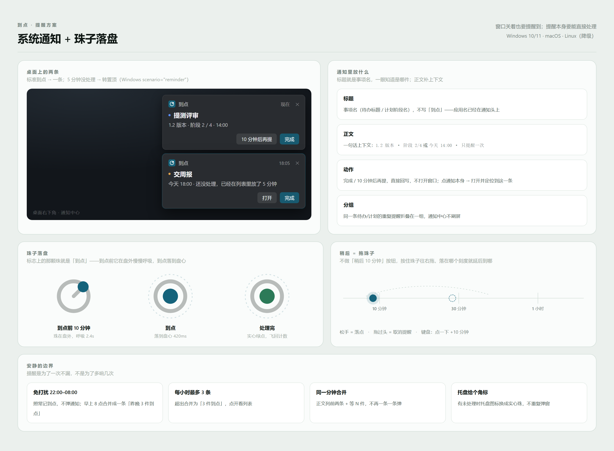

# 到点 · 提醒方案

**一句话：系统通知负责「叫醒」，珠子负责「记住」。** 到点前十分钟，标志上那颗珠在盘外轻轻呼吸；到点时系统通知弹出、珠落到盘心、响一声木头「嗒」；没处理就收成一枚实心珠挂在托盘上，不再重复弹。



## 一、现状

系统通知其实已经在发了（`remind.rs` 用的是 `tauri-plugin-notification`），但只到「能弹出来」这一步：

| 位置 | 现在 | 问题 |
| --- | --- | --- |
| [remind.rs:42-47](../../src-tauri/src/remind.rs) | `title("到点")` + `body(action.body)` | 所有通知长得一样，看不出是哪件事；不能调声音，也不能在通知里直接处理 |
| [remind.rs:10-17](../../src-tauri/src/remind.rs) | 20 秒轮询 + `sleep` | 最多晚 20 秒；电脑休眠回来全挤在一起 |
| [remind.rs:49](../../src-tauri/src/remind.rs) | `show()` 失败不写 `reminded` | 失败后每 20 秒重试一次，通知中心被刷屏 |
| [ReminderToast.vue](../../src/features/shell/ReminderToast.vue) | 应用内再弹一张卡 | 和系统通知重复打扰 |
| 全链路 | 通知不可点、不能处理 | 必须打开窗口才能「完成」 |

## 二、平台能力（决定了方案能走多远）

| 能力 | Windows | macOS | Linux |
| --- | --- | --- | --- |
| 基础通知 | ✅ | ✅ | ✅ |
| 通知里的按钮 | ⚠️ 官方插件不支持，要自己用 WinRT 写 toast XML | ⚠️ 需 UNUserNotification actions | ❌ |
| 置顶直到处理 | ✅ `scenario="reminder"` | ❌ | ❌ |
| 点通知跳回应用 | ✅ | ✅ | ⚠️ 看通知服务实现 |
| 自定义声音 | ✅ 可用自带 wav | ✅ | ⚠️ |

关键一条：**Tauri 官方通知插件的 Actions API 只对移动端开放**（[官方文档](https://tauri.app/plugin/notification/#actions) 明确标了 *Mobile Only*）。所以 Windows 上要「在通知里直接点完成」，得绕过插件，用 `winrt-notification` 自己拼 toast XML。

另一条坑：**未安装时 Windows 可能不弹**。toast 依赖开始菜单里带 AppUserModelID 的快捷方式，NSIS 安装包会建，`tauri dev` 不会。所以必须做「发了但没显示」的兜底，而不是假设它一定成功。

## 三、提醒的状态机

```
        到点前 10 分钟                到点                5 分钟没动
空闲 ─────────────▶ 蓄势 ─────────────▶ 响铃 ─────────────▶ 挂起
                     (珠呼吸)           (通知+落地)        (托盘实心珠)
                                         │  ▲                 │
                              完成/稍后  │  │ 再提醒          │ 打开
                                         ▼  │                 ▼
                                     已处理 ◀──────────────────┘
```

- **蓄势**：只在应用内可见（时间轴上那颗珠开始呼吸），不打扰。
- **响铃**：系统通知一次。判重键 `(target, at)`，同一条只响一次。
- **挂起**：不重复弹窗，托盘图标换成实心珠版；用户点托盘才看到。
- 睡眠/唤醒后补一次扫描，把错过的提醒合并成一条，不逐条补发。

## 四、系统通知放什么

| 字段 | 内容 | 例子 |
| --- | --- | --- |
| 标题 | 事项名，不写「到点」 | 提测评审 |
| 正文 | 一行上下文 | 1.2 版本 · 阶段 2/4 · 14:00 |
| 应用名 | 由系统显示 | 到点 |
| 图标 | 应用图标（自动） | — |
| 按钮 | 完成 / 10 分钟后再提 | 直接回写数据，不开窗口 |
| 点击 | 打开主窗口并定位到该条 | `daodian://item/<id>` |
| 分组 | `daodian:todo` / `daodian:plan` | 通知中心里折叠，不刷屏 |

「稍后」不是无限重弹：每次稍后 +1 次计数，超过 3 次就只挂起、不再响。

## 五、有趣的提醒：珠子落盘

品牌里的那颗珠就是「到点」本身，所以让**提醒的动作发生在珠子上**，而不是再发明一个动画。

1. **蓄势（T-10 分钟）** 珠在盘沿缓慢呼吸：缩放 1 → 1.06 → 1，2.4s 一轮，透明度 0.75 → 1。只出现在应用内的今日时间轴上。
2. **响铃** 珠从 2 点方向沿弧线落到盘心，420ms，`cubic-bezier(.2,.8,.2,1)`；落定瞬间盘外扩散一圈 27px 的细环，300ms 淡出；同时一声木头「嗒」。
3. **完成** 珠变成实心苔绿，1 秒后缩成一个点飞向左侧「今天」计数，计数 +1。
4. **稍后 = 拖珠子** 不做「稍后 10 分钟」按钮。按住珠子往右拖，轨道上有 10 分钟 / 30 分钟 / 1 小时三个刻度，松手落在哪就延后到哪；拖过最右端是「取消这次提醒」。键盘和读屏走按钮：点一下 = +10 分钟。

声音也只用一下：**木头相碰的一记「嗒」**，130ms，衰减 180ms，-18dBFS；重要事项隔 180ms 补一个高五度的短音。不用系统「叮咚」，也不用循环。设置里可关。

## 六、安静的边界

提醒是为了不漏，不是为了多响。

- **免打扰时段**（默认 22:00–08:00）：照常算到点，不弹通知；早上 8 点合并成一条「昨晚 3 件到点」。
- **每小时最多 3 条**系统通知，超出合并成「3 件到点」。
- **同一分钟合并**成一条，正文列前两条 + 「等 N 件」。
- **托盘角标**：有未处理时图标换成实心珠版（`TrayIcon::set_icon`），不靠重复弹窗提醒。
- **三档强度**（设置里）：
  - 安静：只在应用内
  - 标准（默认）：系统通知 + 应用内 + 声音
  - 强：Windows `scenario="reminder"` 常驻到处理为止

## 七、要改的地方

1. **调度**：`remind.rs` 的 20 秒轮询换成「算下一个到点 → `sleep_until`」，每 5 分钟兜底扫一次；监听系统唤醒事件补扫。
2. **发送**：抽出 `Notifier` trait，`#[cfg(windows)]` 走 winrt-notification（按钮 + 置顶 + wav），其他平台走官方插件；失败走指数退避，不要把失败当成功、也不要把失败当可重试。
3. **数据**：`Todo.reminded: bool` 换成 `remind: { at, state, count, lastAt }`，才能支持「5 分钟转挂起」「稍后 3 次封顶」。需要一次 store 迁移（现有 `migrate.rs` 里加一版）。
4. **前端**：`ReminderToast.vue` 改成「珠子卡片」，负责蓄势/落盘/拖动；系统通知的按钮通过事件回到前端执行同一套 `complete` / `snooze`。
5. **入口**：托盘菜单加「暂停提醒 1 小时」。

## 八、分步来

| 阶段 | 内容 | 估时 | 价值 |
| --- | --- | --- | --- |
| P0 | 标题/正文/图标改对、判重、点通知定位、失败退避 | 半天 | 立刻不再刷屏、能认出门道 |
| P1 | 精确调度 + 唤醒补扫 + 合并 + 免打扰 + 托盘角标 | 1–2 天 | 到点不再晚 20 秒，夜里不吵 |
| P2 | Windows 富通知（按钮 + 置顶）+ 声音 | 2–3 天 | 不打开窗口就能处理 |
| P3 | 珠子落盘动效 + 拖珠子稍后 | 2 天 | 手感，也就是这个方案的脸面 |

P0 一个人半天就能落地，建议先做——现在失败重试那个坑已经在刷通知中心了。

## 九、风险与兜底

- **未安装时 toast 不显示**：启动时探测一次（发一条静默探针，或读注册表里的 AUMID 快捷方式），不可用就自动退回应用内卡片，并在设置里提示「安装后可在系统通知里操作」。
- **休眠错过**：唤醒后补扫，错过的一律合并成一条，不补弹 N 条。
- **通知中心里的旧条目指向已删除事项**：点击时校验 id，找不到就只打开窗口。
- **置顶通知刷屏**：置顶只允许同时存在 1 条，新的顶掉旧的。
- **声音打扰**：默认响，但只在「标准」以上；接电话/全屏演示时可被系统「专注助手」接管。

## 十、验收

1. 关窗后 30 秒内，到点事项必弹一条系统通知，标题是事项名。
2. 通知里点「完成」，列表里该条变完成，不再提醒。
3. 同一事项连续三次未处理，只挂起，不重复弹。
4. 22:00 后的提醒不在当晚弹，次日 8 点合成一条。
5. 从通知点进来，窗口打开并定位到该条。
6. 珠子落盘动画在 60Hz 屏上不丢帧，`prefers-reduced-motion` 下退化为淡入。

## 十一、实现状态（2026-10-23）

已落地：

| 项 | 位置 |
| --- | --- |
| 通知标题=事项名、正文=上下文（计划阶段带「阶段 2/3」） | [schedule.rs](../../src-tauri/src/domain/schedule.rs) |
| 判重：同一 (target, at) 只响一次 | `reminded` + [remind.rs](../../src-tauri/src/remind.rs) |
| 发送失败退避：同一条最多试 3 次，之后只记账不再弹 | `Runtime.failures` |
| 精确调度：睡到最近一个到点，最长 5 分钟兜底醒一次 | `next_wait` + `next_due_at` |
| 合并：同一批到点合成一条「N 件到点」 | `compose` |
| 免打扰 22:00–08:00，时区由前端同步（Rust 无时区信息） | `sync_clock` + `in_quiet_hours` |
| 每小时最多 3 条 | `under_cap` |
| 托盘角标：有到点没做完就换成「珠落盘」图标 | [tray.rs](../../src-tauri/src/tray.rs) + `icons/tray-due.png` |
| 珠子卡片：落盘动画 + 拖珠子推后 10/30/60 分钟 | [ReminderToast.vue](../../src/features/shell/ReminderToast.vue) |
| 列表一变就重算，角标立刻收掉 | `sync_reminders` ← `useLibrary.reload()` |

还没做（都卡在 Windows 富通知这一条路上）：

- **通知里的「完成 / 稍后」按钮**：官方插件 Actions 只给移动端，要在 Windows 上做就得直接吃 `tauri-winrt-notification`（它已在依赖树里，v0.8.1），自己拼 toast XML 并接激活回调。
- **点通知打开并定位到该条**：同上，需要注册 AUMID 与 activation 回调；否则点击只关掉通知。
- **声音**：一记木头「嗒」，接在富通知的 `<audio>` 上。

这三项建议一起做，因为它们共用同一个 Windows 分支；做完之后再补 macOS 的 UNNotification actions。

验证情况：`cargo check --tests` 与 `pnpm build` 均通过；本机没有 MSVC 链接器，所以 `cargo test` 和真机弹通知没在这里跑过。
