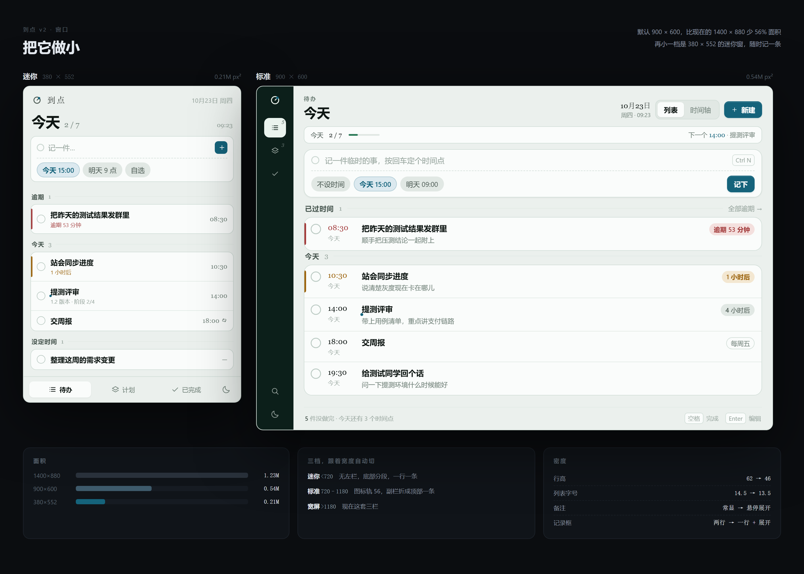
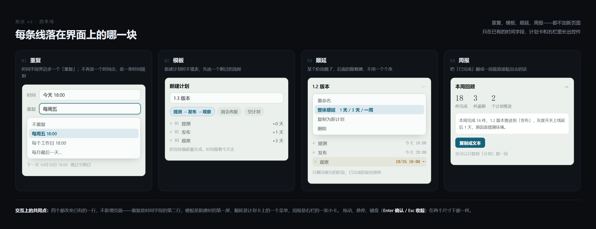

# 到点 v2 · 设计文档

> 一句话：**把窗口做小，把时间点连起来。**
> 这一版不加新页面，只在已有的时间字段、计划卡和右栏里长出控件。



## 0. 版本目标

| 目标 | 度量 |
| --- | --- |
| 打开就能用，不占地方 | 默认窗口面积从 1.23M px² 降到 0.54M（-56%），最小可到 0.21M |
| 一件事能被重复记 | 「每天 9:30 站会」「每周五交周报」不再手动重记 |
| 计划能自己往下走 | 阶段晚了，一条命令顺延；阶段之间能挂依赖 |
| 做得完也说得清 | 一键把本周翻成一段能贴出去的文本 |

## 1. 这一版改什么

| # | 线 | 内容 | 落在哪 |
| --- | --- | --- | --- |
| 1 | 窗口 | 三档尺寸 + 密度收敛 | 全局 |
| 2 | 时间点 | 重复、提前量 | 时间字段 |
| 3 | 计划 | 模板、顺延、依赖 | 计划卡 / 阶段行 |
| 4 | 回顾 | 周报导出 | 右栏 |
| 5 | 外接 | 日历、飞书推送、全局记录 | 设置 + 托盘 |
| 6 | 智能 | 自然语言记一条 | 记录框 |

前三项排 v2.0–v2.1，后三项排 v2.2 以后。**提醒规则、主题、标志、珠子不动。**

## 2. 窗口：把它做小



### 2.1 三档

| 档 | 宽度 | 布局 | 默认 |
| --- | --- | --- | --- |
| 迷你 | < 720 | 无左栏；顶部标题，底部分段切板块；一行一条，备注不显示 | 380 × 552 |
| 标准 | 720–1180 | 图标轨 56；副栏折成顶部一条「今天 2/7 · 下一个 14:00」 | **900 × 600** |
| 宽屏 | > 1180 | 现在这套三栏（导航 246 / 主区 / 副栏 306） | 1400 × 880 |

断点按**窗口宽度**切，不是屏幕宽度——用户可以手动拖到任意宽度。

### 2.2 密度

| 项 | v1 | v2 |
| --- | --- | --- |
| 列表行高 | 62 | 46（标准）/ 42（迷你） |
| 列表字号 | 14.5 | 13.5 |
| 时间列 | 56 | 46 |
| 备注 | 常显 | 悬停展开，触屏常显 |
| 记录框 | 两行常驻 | 一行 + 展开（迷你只有一行） |
| 分组间距 | 20 | 12 |

### 2.3 窗口行为

- 首次启动：900 × 600，屏幕居中，并**限制在可用工作区内**（小于 1024 的屏幕直接开迷你档）。
- 记住每档的上次尺寸与位置；切档时不互相覆盖。
- 最小尺寸 380 × 480；再小就没有意义。
- `Ctrl Shift M` 在迷你/标准之间切换；托盘菜单加一项「迷你窗」。
- 关窗仍进托盘，不退出（沿用 v1）。

## 3. 线一：把时间点连起来

### 3.1 重复

**目标**：一条待办可以是一串时间点。

**UI**：时间字段下面多一行「重复」；默认「不重复」，点开是菜单（不重复 / 每周五 / 每个工作日 / 每月最后一天 / 自定义）。选完这行显示成「每周五 18:00」，列表里标题后跟一个小循环图标。

**交互**：
- 选完立刻显示「下一次 10月30日 18:00」，避免用户自己算。
- 重复事项被标记完成 → 完成的是**这一次**，下一次自动生成，原记录进历史。
- 节假日：默认跳过周末，可在设置里关。

**数据**：`Todo.repeat: { rule, byWeekday?, dayOfMonth?, until? } | null`；`dueAt` 始终是**下一次**的时间。

**风险**：重复 + 提醒 + 完成三者的状态机会绕；先把「完成即滚动到下一次」做对，再做跳过某一次。

### 3.2 提前量

**目标**：重要的事别在到点才说。

**UI**：时间字段右侧一个小的「提前」下拉：到点 / 10 分钟 / 1 小时 / 1 天。

**交互**：提前提醒是**另一条**通知，标题前缀「还有 10 分钟」；到点仍会再响一次。

**数据**：`Todo.leadMs: number`（默认 0）。

### 3.3 模板

**目标**：新建计划时不填表。

**UI**：新建计划的第一屏是三个 chips：`提测 → 发布 → 观察` / `周会改版` / `空计划`。选中后阶段按**偏移量**生成（+0 天 / +1 天 / +3 天），时间从今天算起。

**交互**：模板只是初始值，生成后每个阶段照样能手改；「另存为模板」放在计划卡的 ⋯ 菜单里。

**数据**：`Plan.templateId?: string`；模板本身存 `templates.json`，内置三套。

### 3.4 顺延

**目标**：一个阶段晚了，后面的别一个个改。

**UI**：计划卡右上角 ⋯ → 「整体顺延 ▸ 1 天 / 3 天 / 一周」。

**交互**：
- 菜单里直接显示预览：「3 个阶段 → 10/25」。
- 只挪**没做完**的阶段；已完成的保持原样。
- 执行后 5 秒内可撤销（toast 里的「撤销」）。
- 时间轴视图里拖某个节点，后面阶段跟着动并显示虚线预览；松手才落定。

**数据**：不新增字段，纯计算。

### 3.5 依赖（v2.2）

**目标**：阶段之间能说「等上一个完成后 1 天」。

**UI**：阶段行里一个胶囊：「等 提测 完成后 1 天」；甘特上画一条虚线箭头。

**交互**：上游完成时，下游的 `at` 由「完成时间 + 延迟」算出并接管提醒；手动改过时间就解除依赖（弹一次确认）。

**数据**：`Stage.dependsOn?: { stageId, delayMs }`。

**风险**：有环要检测；调度器要从「遍历时间」变成「拓扑推进」。这是四条线里唯一动调度模型的，放最后。

## 4. 线二：接进来，送出去

- **日历**：读今天到下周的会议塞进副栏时间轴，只读；「导出 ICS」把计划阶段写成日历文件。
- **飞书 / 企微推送**：设置里填 webhook，到点时除系统通知再发一条；失败不影响本地提醒。
- **全局记录**：`Alt Space` 唤起一个 380 宽的输入框（复用迷你窗），回车记下，Esc 收起。
- **一律默认关闭**，第一次用弹一次说明。这条线是可选增强，不能让它变成联网应用。

## 5. 线三：从记到回顾

**UI**：副栏底部一张「本周」卡，点开展开成面板：18 件完成 / 3 件逾期 / 2 个计划推进，下面是一段可编辑的文本 + 「复制成文本」。

**交互**：
- 文本模板可改（设置里一段 markdown）。
- 复制后按钮变「已复制」，2 秒还原。
- 也可以只复制「计划」那一段。

## 6. 线四：智能

- **自然语言记一条**：在记录框里输入「明天下午三点半找王工要接口文档」，回车前出现一行**解析预览**：「明天 15:30 · 找王工要接口文档」——按 Tab 接受，直接回车则当普通文本。永远先给预览，不让 AI 猜。
- **从文本生成计划**：贴一段需求到新建计划，拆成阶段并给建议时间，生成后一样能改。
- 本地优先：解析失败退回原文，不阻塞记录。

## 7. 交互规范

| 场景 | 规则 |
| --- | --- |
| 菜单层级 | 最多两层（⋯ → 子菜单）；Esc 逐层收起 |
| 撤销 | 顺延、删除、改重复规则，都给 5 秒撤销 |
| 悬停 | 行内显示备注与操作；触屏下常显 |
| 键盘 | 空格完成 / Enter 编辑 / R 重复 / T 顺延 / Ctrl N / Ctrl K |
| 空态 | 每档都保留一句话说明这个筛选是干嘛的 |
| 加载 | 不整屏 spinner，列表骨架 + 顶部错误条 |

## 8. 数据结构与迁移

```ts
Todo  += { repeat: Repeat | null; leadMs: number }
Stage += { dependsOn?: { stageId: string; delayMs: number } }
Plan  += { templateId?: string }
store.json += { version: 2, settings: Settings }
```

迁移：读到 v1 文件时补默认值（`repeat: null`、`leadMs: 0`），写回时升级为 `version: 2`；旧文件备份成 `store.v1.bak.json`。沿用现有 `migrate.rs` 的思路。

## 9. 分期

| 版本 | 内容 | 验收 |
| --- | --- | --- |
| **v2.0**（2 周） | 窗口三档 + 密度 + 重复 + 提前量 | 900×600 下列表一屏 8 条；每周五能自动滚到下周 |
| **v2.1**（2 周） | 模板 + 顺延 + 撤销 | 新建计划 3 秒内完成；顺延后所有未完阶段对齐 |
| **v2.2**（3 周） | 周报 + 依赖 | 周报一段话复制即用；依赖完成后下游自动排期 |
| **v2.3**（4 周） | 日历、飞书、全局记录、自然语言 | 全部默认关闭，开了能关掉 |

## 10. 不做

- 不加「仪表盘」「统计大屏」——这不是数据产品。
- 不做多人协作、看板拖拽、评论——那是另一个产品。
- 不把窗口做成可换肤的编辑器（无侧边栏树、无标签页）。
- 不为迷你档砍功能：迷你只是**少显示**，不是少能力，点开还是同一个编辑抽屉。

## 附：对应的文件

- [windows.png](out/windows.png) —— 三档尺寸与密度
- [features.png](out/features.png) —— 四条线在界面上的落点
- [mini.html](mini.html) / [standard.html](standard.html) —— 可打开的静态原型
